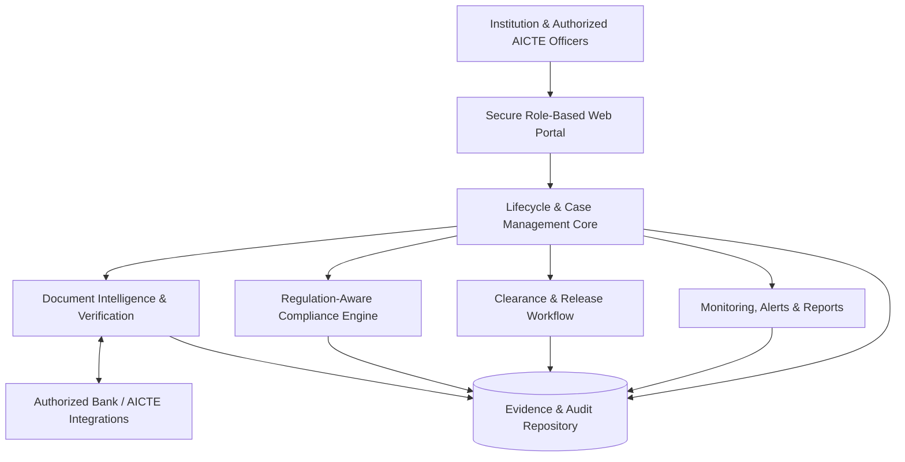
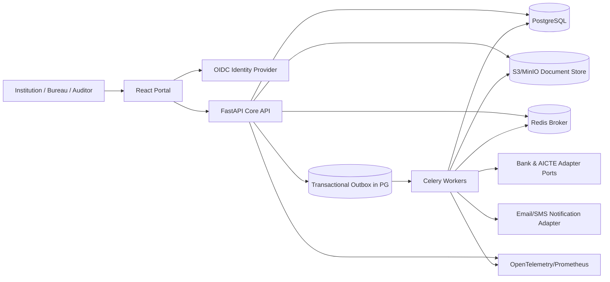

# FDR Sentinel — Architecture Decision Record / Implementation Blueprint

**Project:** SIH26265 — Streamline of Security Deposit / FDR Portal  
**Version:** 1.0 — 23 October 2026  
**Status:** Proposed architecture; not an implemented system or an approved AICTE integration.  
**Primary audience:** coding agents, architects, developers, evaluators  
**Main objective:** auditable management of institutional security deposits and FDR/RTGS/RPGF instruments, from recording through verification, lifecycle tracking, and authorized release.

## 0. Essential source and status boundaries

- SIH26265 public mirror: https://zaidsayyed.in/tools/sih-problem-statements/sih26265 . Ten requested capabilities: repository, documents, verification, maturity/validity, renewal/replacement, release/refund, alerts, dashboards, audit/access, secure integration.
- **Primary normative reference:** AICTE Approval Process Handbook 2024–2027, official PDF: https://www.aicte.gov.in/sites/default/files/APH%20Final.pdf . Relevant Clause **1.12**, Table **1.4** (amounts / exceptions), Clause **6.46** (release), and DOs/DON'Ts (online applications). Check corrigenda/updated policies before any real use.
- AICTE ALREADY provides online submission and tracking for release. Position as a complementary verification + lifecycle + workflow modernization product, not the first online application portal.
- Production deployment, banking integrations, actual AICTE data access and legal suitability require written authorization, security review, and a tested deployment plan.
- Prototype uses synthetic institutions, sample documents and a clearly marked mock bank/AICTE adapter. Never present mock verification as real bank confirmation.
- Historical policies differ. Never assume renewal is permitted in every case. Use a versioned, effective-dated rule set, with review for exceptions and bank auto-renewal.

## 1. Decision and deployment topology

**Architecture choice: modular monolith + separately scalable async workers.** Do not start with microservices, Kafka, Kubernetes, blockchain, autonomous regulatory agents or a trainable fraud model. Split to services only with observed scaling/ownership need.

**Web**: React + TypeScript + Vite, TanStack Query, React Hook Form + Zod, Tailwind/shadcn.  
**API/Core**: Python FastAPI, Pydantic v2, SQLAlchemy 2 + Alembic, REST OpenAPI, modular domain services.  
**Database**: PostgreSQL (authoritative state, data integrity, full-text search, JSONB only for controlled policy/evidence metadata).  
**Workers**: Celery + Redis (OCR, asynchronous checks, report generation, scheduled reminders, email dispatch). Run Celery Beat as SINGLE scheduler instance; handle concurrency/idempotency in PostgreSQL.  
**Document store**: S3-compatible storage (MinIO local, approved encrypted S3-compatible service for production) with immutable versioned objects / retention where possible.  
**Identity**: OIDC with Keycloak (local / self-host) or approved government IdP (later); role permissions AND resource-scope checks in API.  
**Observability**: OpenTelemetry traces, Prometheus metrics, Grafana, structured JSON logs, Sentry-like alerting if approved.  
**Deployment**: Docker Compose for local/demo; separate worker/web/API/db/object storage containers; managed Postgres + object store in production; K8s only after justified requirements.

### PPT-level architecture (technology-independent)



### Deployment/component diagram



## 2. Bounded modules (same deployed API, explicit boundaries)

1. `identity_access` — principal, role, assigned institution/bureau scopes, permissions, immutable identity subjects; no homegrown JWT issuance.
2. `institutions` — AICTE institution ID, legal entity, programmes/levels, land/lease classification, regulatory approval history, exceptional conditions, document references.
3. `obligations` — what deposit is due, how much, why, reference to effective-dated policy; historical calculation snapshots.
4. `instruments` — FDR/RTGS/RPGF records; separate independent **verification**, **lifecycle**, **administrative** dimensions; renewal/replacement lineage.
5. `documents` — direct signed uploads, malware detection, MIME/size validation, immutable original object, SHA-256 hash, extraction result and provenance.
6. `verification` — compare document evidence, institution assertions and authorized external-source attestations. Discrepancy registry and reviewer dispositions. No AI self-certification.
7. `compliance` — deterministic rule evaluator, versioned rule sets by effectivity, cited clauses and override/exception records.
8. `release_cases` — release/refund request, required documents, dynamic clearance tasks, holds, approvals and FDR/RPGF NOC vs RTGS sanction order branches.
9. `alerts_reporting` — reminder schedule, escalation policies, case work queues, reproducible aggregate reporting, exports.
10. `audit_integrations` — append-only event log, transaction outbox, connector adapters, replays and reconciliation.
11. `document_ai` (worker) — format sniffing, text extraction (PyMuPDF), OCR (Tesseract), optional approved vision extraction, typed field parser, confidence + evidence coordinates, no automatic approval.

**Boundary rule:** Module-to-module calls through typed service interfaces; one database with schema ownership and controlled repository access. No cross-module ORM-object mutation from other modules.

## 3. Data model (minimum)

- `users` / `principal_assignments` (OIDC subject, role, bureau_id/institution_id scope, enabled)
- `institutions` (id, AICTE identifier, legal entity id, classifications)
- `institution_approvals` (LoA/EoA, time period, programme level, proof document)
- `deposit_obligations` (institution id, regulation version, legal factors, required amount in INR paise integer, rationale, effective dates, case state)
- `instruments` (id, institution id, obligation id, type FDR|RTGS|RPGF, bank name / masked reference / encrypted reference, amount_paise, issue_date, maturity_date, owner, verification_status, lifecycle_status, lock_version, created_at)
- `instrument_relationships` (from_id, to_id, reason: replacement/renewal/auto-renewal/correction; immutable link) 
- `documents` (id, tenant/institution id, object_uri, SHA256, MIME, size, version, uploader, scan_status, retention category)
- `extracted_fields` (document id, field, typed value, extraction method/model version, confidence, page + bounding coordinates / character offsets, review state)
- `verification_requests` (source adapter, request ID, idempotency key, requested_at, status)
- `verification_attestations` (instrument, source, external reference, verified fields, evidence ref, source_at, retrieved_at, authenticity level, expiry)
- `discrepancies` (severity, source fields, evidence references, status, resolution, adjudicator)
- `policy_versions` / `policy_rules` (document name, edition, effective window, clause, structured conditions, rule version/checksum, test fixture version)
- `compliance_evaluations` (inputs snapshot/hash, rule version, pass/fail/review results, source clauses, created_at)
- `release_cases` (instrument id, request type, submission date, case state, assigned officer, type-specific output)
- `clearance_requirements` and `clearance_decisions` (case, bureau, required_by_rule, state, decision, signed/identified actor, notes, evidence ref)
- `holds` (case or instrument, basis, start/end, authority, release prerequisites)
- `notifications` (dedupe key, recipient, type, status, attempted_at)
- `audit_events` (actor, subject, action, event_time, before/after hashes, trace id, reason, immutable append operation)
- `outbox_events` (unique event id, aggregate, payload schema version, delivery status, retry count).

Database constraints: amounts >0; maturity >= issue (when known); composite unique on bank+normalized instrument number (subject to domain review); unique Idempotency-Key per principal/operation; FKs and check constraints; lock_version for concurrent updates; documents never updated in place; lifecycle history explicit; all critical state changes and audit/outbox committed together.

## 4. State separation and regulatory flow

Do **not** represent verification, temporal state and clearance as a single `status` field. For example, an FDR may be `BANK_VERIFIED`, `MATURED`, and `RELEASE_HELD` at the same time.

- `verification_status`: UNVERIFIED, PENDING_EXTERNAL, BANK_CONFIRMED, MANUALLY_REVIEWED, DISPUTED, UNAVAILABLE. A manually reviewed record is **not** bank-authenticated.
- `lifecycle_status`: RECORDED, ACTIVE, APPROACHING_MATURITY, MATURED, REPLACED, RELEASED, FORFEITED, OTHER_EXCEPTION. Derived/managed with precise authoritative dates and controls.
- `release_case_state`: DRAFT, SUBMITTED, DOCUMENT_REVIEW, CLEARANCES_PENDING, APPROVAL_REVIEW, APPROVED, REJECTED, NOC_ISSUED, SANCTION_ISSUED, COMPLETED, CANCELLED, ON_HOLD.

**State transitions:**

1. Institution submits release request, supporting request letter, Affidavit 6, applicable FDR/online deposit proof, latest LoA/EoA.
2. Evidence validator checks presence and cross-document consistency, references policy version; failures become reviewer tasks.
3. Clearance engine identifies PGRC, Vigilance and other applicable bureaus, as well as conditional NOCs/holds and special cases.
4. Each authorized bureau records approved/rejected/pending decisions (with scope, evidence, signed actor and time). Any blocking hold prevents approval.
5. Competent officer authorizes the case. No LLM and no background worker may bypass authorization.
6. For FDR/RPGF, generate tracked draft NOC and record issuance by authorized Approval Bureau actor; for RTGS, generate tracked sanction order requiring Council-authorized issuance.
7. Record case completion and any external bank-release settlement confirmation separately. Never simulate actual payment movement.

Rules must cover both standard and exception flows (closed/merged institution; private university conversion; government/aided exceptions; land lease factor; policy-era differences; existing-deposit credit; expiry vs release; suspected financial irregularities). Unknown circumstances => `REQUIRES_HUMAN_REVIEW` not automatic eligibility.

## 5. Document and verification pipeline

`presigned secure upload -> quarantine object -> MIME/magic-byte and extension validation -> size/page limits -> antivirus scan -> SHA-256 -> immutable original -> extract digital PDF text -> OCR only when needed -> structured typed field extraction -> confidence/evidence -> cross-document validation -> optional authorized bank verification -> officer review`.

- Document types: FDR, bank certificate, payment receipt, Affidavit 3/6, LoA/EoA, renewal/replacement evidence, release request, bureau NOC, supporting case evidence.
- Authoritative truth levels: `INSTITUTION_DECLARED`, `DOCUMENT_EXTRACTED`, `OFFICER_REVIEWED`, `BANK_CONFIRMED`, `AICTE_SYSTEM_CONFIRMED`. Never collapse these levels.
- Numeric/rule assertions only from typed structured fields + deterministic validations; optional LLM can assist extraction/explanation but cannot certify authenticity or release funds.
- Evidence every finding: document ID + hash + page/offset + asserted value + expected value + policy reference + validation algorithm/version.
- Unknown authenticity stays unknown, not passed. Duplicate-document SHA matches are a signal, not proof of financial fraud.
- No upload to external AI vendor unless data policy authorizes it; use mock/synthetic data for hosted demo models.
- No active RAG required for primary policy decisions. Optional read-only handbook Q&A can use Postgres FTS/pgvector later and must clearly say non-authoritative advisory guidance.

### External adapters

Port contract: `request_verification(record_id, requested_fields, idempotency_key)` and `poll_or_ingest_attestation(correlation_id)` return structured source, status, signed evidence reference, timestamp, trace ID. Implement `MockBankAdapter`, `ManualEvidenceAdapter`, `CSVImportAdapter`, and stub `AuthorizedBankAPIAdapter`; similarly for `AICTEInstitutionRegistry` and `AICTECaseSystem`. Permission/credential gates prevent mock adapters in production. Use callbacks only with signed payload checks, replay protection and allowlisted sources.

## 6. Security and controls

- OIDC authentication; secure httpOnly cookies where applicable; MFA for high-privilege approval roles; server-side RBAC + resource-based authorization per institution and bureau. Deny-by-default.
- Maker/checker separation: institution uploader cannot verify; same officer cannot both originate and provide required independent approval; cannot clear on behalf of another bureau.
- All inputs validated via Pydantic; parameterized SQL; CSRF protections if cookie auth; rate limits; timeouts; CORS allowlist; no SSRF via document URLs; restricted outbound worker egress; no direct public object storage bucket.
- Private uploads with short-lived signed URLs; file signature scan, antivirus, size/page cap, isolated processing, metadata stripping where needed; encrypted at rest/TLS; secrets only via proper vault/secret store; safe redaction in logs.
- Document retention / deletion/legal hold is configurable subject to organizational policy; never invent a fixed legal retention term.
- Append-only application audit tables, chained digests or externally checkpointed exports (actual tamper-evidence requires external/immutable anchoring; hash alone is not tamper-proof). Separate access logs.
- Adversarial OCR and prompt-injection threats: untrusted document contents are data only; no tool invocation or hidden prompts from document content; redact/validate outbound data; AI output always parsed to strict schema with bounded fields.
- Resilience: outbox pattern; retry/dead-letter queues; replay-safe workers; idempotent notifications; structured incident logging, backups, tested point-in-time recovery; database transaction boundaries.

## 7. Public-facing contracts (initial REST /api/v1)

- `GET /me`, `GET /institutions`, `GET /institutions/{id}` (role scoped)
- `POST /institutions/{id}/obligations/evaluate` (authorized recompute with policy ref)
- `GET /instruments?institution_id=...&state=...`, `POST /instruments`, `GET /instruments/{id}`
- `POST /documents/upload-intents`, `POST /documents/{id}/finalize`, `GET /documents/{id}/download-link` (authorized)
- `POST /instruments/{id}/verify`, `GET /instruments/{id}/findings`
- `POST /instruments/{id}/replace`, `POST /instruments/{id}/record-renewal` (subject to policy guard)
- `POST /release-cases`, `GET /release-cases/{id}`, `POST /release-cases/{id}/submit`
- `POST /release-cases/{id}/clearances/{bureau}/decision`, `POST /release-cases/{id}/approve`, `POST /release-cases/{id}/issue-document`
- `GET /dashboard/summary`, `GET /work-queue`, `GET /reports/*`, `GET /audit-events` (scoped)
- `GET /health/live`, `GET /health/ready` (suppress sensitive details)

All mutating endpoints include idempotency and immutable audit data; concurrency handled with HTTP conditional requests/ETags or lock_version, plus DB constraints. Generate OpenAPI clients for React. Prefer endpoint operations like `submit`, `approve`, `replace` over unconstrained `PATCH state`.

## 8. Demo-ready user journeys / acceptance tests

- **D1 New submission**: institution creates instrument + upload; async extraction shows exact document fields and editable proposed values; human verifies.
- **D2 Discrepancy**: issue date, amount, institution identity or bank reference conflicts with supporting document; provenance shown; reviewer resolves with evidence.
- **D3 Rule evaluation**: sample new Engineering & Technology UG obligation evaluates under 2024–27 Table 1.4 (₹35 lakh base) and private lease factor (2×) if applicable; exceptions evaluated accurately; every outcome cites clause. Amount calculations are *illustrative* and not blanket rules.
- **D4 Maturity**: simulated clock/time travel creates 90/30/7-day alerts (configurable product policy, NOT AICTE-mandated statutory deadlines). Repeat sends are idempotent; matured != automatically releasable.
- **D5 Replacement/renewal**: linked new instrument retains old one, full source evidence, maturity and timeline history; policy can require manual authorization.
- **D6 Release blocked**: submit four primary document categories, valid maturity, PGRC pending and Vigilance cleared; issuance must be blocked with explainable reason.
- **D7 Authorized release**: clear remaining requirements by authorized roles, competent approval, generate mock/synthetic NOC (FDR/RPGF) or sanction draft (RTGS), audit every transition.
- **D8 Security**: institution A cannot see B's data; PGRC actor cannot forge Vigilance clearance; replay upload/approval requests cannot duplicate actions.
- **D9 Bank source distinction**: bank adapter mock gives signed demo confirmation; UI labels `SIMULATED` and never claims authentic bank verification; manual review is not bank verification.
- **D10 Observability**: failed OCR, delayed external verification, notification retries are traced and do not silently become approved.

## 9. Quality gates, implementation sequence and measurement

### Stage 0: Foundation / agent onboarding
- Freeze assumptions, source/brief reference, threat model, module ownership, OpenAPI version and seed fixtures. Generate synthetic PDF/CSV data, mock bank attestations and negative cases. Set CI lint/typecheck/pytest; Postgres+MinIO+Redis+Keycloak local Compose.

### Stage 1: Regulatory backbone / non-AI vertical slice
- Implement auth/scope, institution/obligation, instrument records, versioned policy rule evaluator, release workflow and audit. **Acceptance**: D3, D6, D8 fully pass before AI is added.

### Stage 2: Document intelligence and verification
- Upload quarantine, malware scan, PDF parsing, OCR, typed extraction with coordinates, discrepancy creation, human correction and bank-source adapter. **Acceptance**: D1, D2, D9 with fixture tests.

### Stage 3: Monitoring, lifecycle and dashboard
- Renewal/replacement lineage, reminder jobs, work queues, reporting, exports, alerts and role-specific UI. **Acceptance**: D4, D5, D7.

### Stage 4: Production hardening, demo and evaluation
- Threat-focused tests, concurrency/idempotency, 100–1000 institution synthetic seed, load tests, tracing, backups and restore drill, demo scripts, release checklist, offline-capable fallback seeded environment. **Acceptance**: D10 + green CI.

**Measured rather than invented impact:**
- Field-level extraction precision/recall on labelled synthetic sample (split by document type).
- Correctness on seeded regulatory positive/negative/edge-case tests.
- Human-review turnaround for fixed scripted scenarios before vs after portal.
- Number of missed reminders/duplicate alerts in injected clock tests.
- Workflow completion time and pending-clearance visibility.
- Authorization violations blocked (100% expected in security test suite); audit coverage for every critical transition.

Report sample size, conditions and limitations. Do not claim bank verification accuracy without genuine authorized reference data.

## 10. Agent contract / decisions not to change casually

- **Must-have:** PostgreSQL as single source of truth; typed domain services; separate status dimensions; policy evidence and versioning; immutable uploaded originals; human-authorized release and independent bureau approvals; real API and synthetic dataset; evidence-linked validation findings.
- **Must-not:** LLM-approve deposits, hallucinate bank confirmation, send real bank instructions, bypass cross-bureau clearances, treat maturity as eligibility, collapse all deposit state into one field, call document-hash matches fraud proof, cite obsolete policy as current without version tags.
- **Deliverable artifacts:** `docs/ps-and-source-mapping.md`, `docs/architecture.md`, `docs/domain-rules.md`, `docs/threat-model.md`, `docs/demo-script.md`, `docs/adr/`, `openapi/`, `tests/fixtures/`, `docker-compose.yml`, `README.md`, `AGENTS.md`.
- **Definition of done:** A fresh clone boots with `docker compose up`, seeds demo fixtures, documents credentials and fixture-only integration limits, passes CI, and demonstrates D1–D10 from browser and API without manual database edits.

## 11. Repository structure

```text
fdr-sentinel/
  AGENTS.md
  README.md
  docs/
    architecture.md
    ps-and-source-mapping.md
    domain-rules.md
    demo-script.md
    threat-model.md
    adr/
  apps/
    web/                    # React UI, typed API client
    api/                    # FastAPI app
      app/
        common/             # config, auth middleware, DB, events
        modules/
          institutions/
          obligations/
          instruments/
          documents/
          verification/
          compliance/
          release_cases/
          alerts_reporting/
          audit_integrations/
        api/v1/
        db/migrations/
    worker/                 # Celery queues/tasks, document pipeline
  packages/
    contracts/              # schemas/OpenAPI generated TS client
    policy-fixtures/        # effective-dated reference rule fixture data
  infra/
    compose/
    deployment/
    observability/
  tests/
    unit/
    integration/
    contract/
    e2e/
    security/
    fixtures/
  scripts/
    seed_synthetic_demo.py
    test_clock.py
    run_demo.sh
  .github/workflows/
  docker-compose.yml
```

## 12. PPT framing (single architecture slide + a second demo story slide)

**Architecture headline:** `FDR Sentinel: A Policy-Aware Verification & Clearance Platform`.

**Six blocks to draw:** Users/Roles -> Secure Portal -> Lifecycle Core -> Intelligence+Compliance (side-by-side) -> Cross-Bureau Release Workflow -> Evidence Store+Alerts/Audit. Put bank/AICTE connector as dashed external integration and label it `authorized/optional`.

**Strongest judge scenario:** Institution uploads an FDR; extracted amount conflicts with its applicable obligation; a discrepancy with source evidence appears; a release is attempted for a matured FDR; pending PGRC clearance blocks authorization; PGRC officer clears; Approval Bureau issues a sample NOC; complete audit timeline is visible.

**PPT note:** Use explicit `implemented`, `simulated`, and `planned` labels. No projected ROI, digital signatures, banking access or AICTE integrations presented as live without proof.
