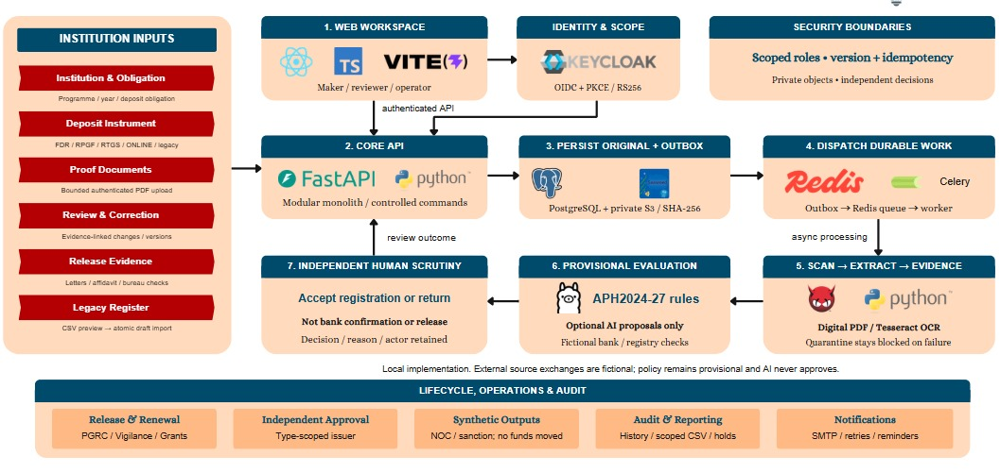

# FDR Sentinel

**SIH26265 | A traceable workspace for institutional security deposits.**

FDR Sentinel brings deposit records, proof documents, scrutiny, maturity follow-up and
release cases into one role-scoped workflow. Institutions submit evidence; independent
officers review it; the system retains the source, decision, reason and history.

This repository contains a working local application and a separate browser simulation.
The local application uses real authentication, storage, scanning, OCR, database
transactions and network exchanges over **fictional institutions and instruments**.
Bank/AICTE exchanges use an independent fictional sandbox, not authorized external systems.
APH 2024-27 rules are provisional. No real funds move, and no regulatory approval is claimed.

## Start with the right demonstration

| Track | What it demonstrates | What it does not prove |
|---|---|---|
| Local full stack, `http://localhost:8088` | Keycloak login, private evidence, ClamAV/Tesseract processing, human decisions, durable jobs, sandbox HTTP and local SMTP | Authorized bank or AICTE integration, production security or legal suitability |
| [Interactive browser demo](https://fdr-sentinel-demo.vercel.app) | Credential-free exploration of shared screens with named synthetic personas | Backend execution, authentic documents, real email or external verification |

For a judging walkthrough, use the [judge guide](docs/JUDGE_GUIDE.md). For exact steps,
use the [demo runbook](docs/SIH_DEMO_RUNBOOK.md). For historical executed checks and their
limits, see [status](docs/STATUS.md) and [measurements](docs/MEASUREMENTS.md).

## Why this exists

Deposit handling is more than storing a PDF. A reviewer needs to know which obligation a
record covers, which proof is current, whether an independent source agrees, which
clearances are missing, and who can make the next decision. Separate spreadsheets and
message threads make that history hard to reconstruct.

FDR Sentinel keeps those questions linked to a single case without making the machine the
approver. It complements existing online application processes; it is not presented as
the first online AICTE release portal.

## Architecture



[Read the current architecture](ARCHITECTURE.md) for component responsibilities, durable
work, security boundaries and the distinction between implemented and proposed features.
The supplied diagram describes the local system. External source exchanges are fictional;
AI remains advisory and never approves.

## What the application covers

| Workflow | What is implemented | Decision boundary |
|---|---|---|
| Institution and deposit intake | Onboarding, obligation context, FDR/RPGF/RTGS/online/legacy records, integer-paise amounts | Imported CSV records remain DRAFT |
| Evidence | Bounded authenticated PDF upload, immutable originals and SHA-256, quarantine, ClamAV, digital extraction and Tesseract OCR | Failed or pending scanning cannot satisfy proof requirements |
| Review and correction | Protected previews, annotations, discrepancy disposition, independent transcription confirmation and retained history | Workers/AI cannot accept registration or claim authenticity |
| Provisional evaluation | Versioned APH 2024-27 fixtures with citations and unknown-context review | Not a complete legal interpretation or certification |
| Source checks | Persisted HTTP requests, retries, signed responses and field comparison against an independent fictional ledger | A sandbox match is not real bank confirmation |
| Maturity and replacement | Configurable reminders, local SMTP, independent renewal/replacement authorization and lineage | Replacement does not release funds |
| Release cases | Evidence requirements, scoped PGRC/Vigilance/Grants tasks, blocking holds, independent approval and type-scoped issuance | Outputs are synthetic NOC/sanction documents, not settlement |
| Reporting and follow-up | Scoped totals, search/pagination, audited safe CSV, interventions, acknowledgement and escalation | Product SLAs are not statutory deadlines; acknowledgement is not approval |
| Access and audit | OIDC roles plus institution/case/bureau scope, version/idempotency checks, decision actor and reason | Operator access cannot make financial decisions |

These are implementation descriptions, not a claim that every path passed in the latest
recording or hosted CI. The [acceptance map](docs/SIH_ACCEPTANCE.md) names the relevant
checks; [verification notes](docs/VERIFICATION.md) separate current CI evidence from older
local qualification.

## Run the local full stack

Requires Docker with Compose. Python 3.12+ is needed for host-side scripts/tests; Node 24
is needed for frontend development. Do not expose this development stack publicly.

```bash
python scripts/bootstrap.py
docker compose up --build -d
docker compose ps
```

- Portal: `http://localhost:8088`
- Identity provider: `http://localhost:8081`
- Fictional sandbox API: `http://localhost:8092/docs`
- Mailpit captured inbox: `http://localhost:8025` (SMTP `localhost:11025`)

Bootstrap generates credentials in ignored `.env`. Never commit, screenshot or share it.
Accounts are `institution`, `other-institution`, `reviewer`, `pgrc`, `vigilance`, `approver`,
`issuer`, `auditor` and `operator`. Match each to `DEMO_<USER>_PASSWORD`, replacing hyphens
with underscores. New institutions need explicit operator-assigned officer scope.

Initial image pulls and antivirus definitions can take several minutes. Do not bypass
quarantine to make a demo faster. Generate visibly fictional PDFs using
`python scripts/generate_fixtures.py` in the installed environment.

All dependency ports bind loopback: PostgreSQL `55432`, Redis `56379`, S3-compatible
SeaweedFS `59000`, ClamAV `53310`. Original financial references use a keyed digest and
last four digits; future real reconciliation needs managed-key design and authorization.

## Development and checks

```bash
python -m venv .venv
# Activate .venv using your shell's normal activation command.
python -m pip install -r requirements.lock
python -m pip install --no-deps -e .
npm ci --prefix apps/web
npm run typecheck --prefix apps/web
npm run build --prefix apps/web
ruff check --no-cache apps/api scripts tests
docker compose --profile test run --rm test
python scripts/local.py -m pytest -q -m browser
```

The backend suite uses a dedicated `sentinel_test` database and actual local services.
The browser suite is separate and needs the live portal. Unit rules can run without the
stack: `pytest tests/test_rules.py`. For containerized lint, use
`docker compose run --rm --no-deps api ruff check --no-cache apps/api scripts tests`.
The API container stays read-only; lint must not try to cache in `/app`.

[Verification notes](docs/VERIFICATION.md) explain CI, local checks, safe recovery and
what has not been requalified. Never delete persistent volumes containing needed data.

## Optional local AI

Ollama support is opt-in, disabled by default, and uses no configured external AI vendor.
Set `AI_ASSIST_ENABLED=true` and `AI_BASE_URL` in ignored `.env`, install the configured
model, then recreate API/worker. See the existing [runbook](docs/SIH_DEMO_RUNBOOK.md) and
[measurements](docs/MEASUREMENTS.md) before presenting it. Proposals must be tied to source
text and independently confirmed. No extraction-accuracy improvement is claimed.

## Documentation map

- [Judge guide](docs/JUDGE_GUIDE.md): problem, workflow, differentiation and evidence limits.
- [Current architecture](ARCHITECTURE.md): implementation map and security boundaries.
- [Demo runbook](docs/SIH_DEMO_RUNBOOK.md): role-by-role demonstration steps.
- [Requirement coverage](docs/PROBLEM_STATEMENT_COVERAGE.md): requested capability and remaining acceptance.
- [Verification](docs/VERIFICATION.md), [status](docs/STATUS.md), [measurements](docs/MEASUREMENTS.md): separate current and historical evidence.
- [Acceptance scenarios](docs/SIH_ACCEPTANCE.md) and [architecture decisions](docs/ARCHITECTURE_DECISIONS.md).
- [Historical blueprint](docs/ARCHITECTURE_BLUEPRINT.md): original design, not the current implementation inventory.

## Before any real deployment

Obtain policy-owner review, official integration contracts and credentials, real identity
assurance, TLS, approved encryption/KMS and retention, independent security assessment,
operational ownership and representative consented pilot evidence. Local recovery drills
are not production RPO/RTO commitments. Synthetic measurements are not evidence of human
time savings, legal compliance, bank authenticity or production accuracy.
